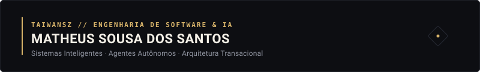

  

  <a href="https://mth3us-portfolio.vercel.app">Portfolio</a> &nbsp;•&nbsp;
  <a href="https://www.linkedin.com/in/mth3us/">LinkedIn</a> &nbsp;•&nbsp;
  <a href="mailto:std.matheus@gmail.com">std.matheus@gmail.com</a>

 

### About

AI Engineer and Full-Stack Developer building autonomous multi-agent runtimes, high-integrity financial backends, and token-efficient architectures. B.S. in Computer Science (8th semester) at UniMAX.

---

### Selected Systems

- **[Thallium](https://github.com/Taiwansz/Thallium)**  
  Enterprise digital banking core and double-entry ledger. Enforces non-negative balances ($S \ge 0$) and race-condition elimination via atomic PostgreSQL stored procedures (RPCs) and Supabase RLS.  
  `Next.js 16` &nbsp;•&nbsp; `Tailwind v4` &nbsp;•&nbsp; `TypeScript` &nbsp;•&nbsp; `PostgreSQL / Supabase` &nbsp;•&nbsp; `Playwright`

- **[Atlas OS](https://github.com/Taiwansz/atlas)**  
  Multi-agent engineering operating system. Eliminates architectural drift and context amnesia through persistent cognitive memory (ADRs), constitutional quality scoring, and modular execution.  
  `TypeScript` &nbsp;•&nbsp; `Node.js` &nbsp;•&nbsp; `Nx Monorepo` &nbsp;•&nbsp; `Docker`

- **[TokLang](https://github.com/Taiwansz/TokLang)**  
  Zero-latency heuristic prompt compression middleware. Strips grammatical redundancy client-side in sub-5ms before LLM API ingestion.  
  `JavaScript` &nbsp;•&nbsp; `Node.js` &nbsp;•&nbsp; `Vercel`

- **Ad Creative Studio**  
  Automated marketing script and asset generation pipeline powered by GPT-4o Vision multimodal feature extraction. *(Private Enterprise Repo)*  
  `Next.js 15` &nbsp;•&nbsp; `TypeScript` &nbsp;•&nbsp; `Supabase`

---

### Recognition

- **1st Place — TechDay UniMAX:** Awarded for *Tharium House*, an interactive 3D game prototype featuring real-time AI behavior systems *(distinct from Thallium banking core)*.

---

### Stack

- **Core:** TypeScript, Python, SQL (PostgreSQL), JavaScript, C++
- **Frameworks & UI:** Next.js (App Router), React, Tailwind CSS, FastAPI
- **Data & Infra:** PostgreSQL (RPCs, RLS), Supabase, Docker, Git, CI/CD

---

<b>Versão em Português</b>

 

Engenheiro de IA e Desenvolvedor Full-Stack focado em arquitetura de agentes autônomos, ledgers financeiros de alta integridade e compressão de contexto em LLMs. Bacharelando em Ciência da Computação (8º semestre) na UniMAX.

- **Thallium:** Core bancário e ledger de dupla entrada com RPCs atômicas em PostgreSQL e liquidação Pix.
- **Atlas OS:** Sistema operacional de engenharia com governança multiagente e memória persistente (ADRs).
- **TokLang:** Middleware de compressão semântica de prompts executado localmente em menos de 5ms.
- **Ad Creative Studio:** Pipeline multimodal de copywriting e criativos com GPT-4o Vision.
- **1º Lugar TechDay UniMAX:** Conquistado com o projeto *Tharium House* (jogo 3D com IA em tempo real).

---

  <picture>
    <source media="(prefers-color-scheme: dark)" srcset="https://raw.githubusercontent.com/Taiwansz/Taiwansz/output/pacman-contribution-graph-dark.svg">
    <source media="(prefers-color-scheme: light)" srcset="https://raw.githubusercontent.com/Taiwansz/Taiwansz/output/pacman-contribution-graph.svg">
    
  </picture>

