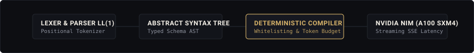
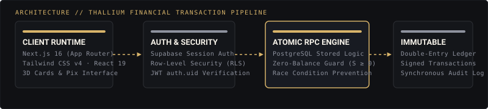
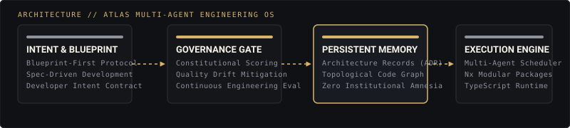

  

  <a href="https://mth3us-portfolio.vercel.app">Portfólio</a> ·
  <a href="https://www.linkedin.com/in/mth3us/">LinkedIn</a> ·
  <a href="mailto:std.matheus@gmail.com">std.matheus@gmail.com</a>

 

### Sobre

Engenheiro de Software e Arquiteto de Sistemas focado na engenharia de compiladores de contexto para LLMs, sistemas multiagentes autônomos e backends transacionais de alta integridade. Bacharelando em Ciência da Computação (8º semestre / Formatura 2026) no Centro Universitário Max Planck (UniMAX).

Minha abordagem de engenharia prioriza rigor estrutural e determinismo: substituir cadeias de prompts desestruturadas por compiladores formais dotados de Árvore de Sintaxe Abstrata (AST) e orçamentação rígida de tokens, e governar a consistência patrimonial no nível do banco de dados com stored procedures atômicas (RPCs) e modelagem bitemporal.

---

### Projetos em Destaque

#### 01. [TokLang — Deterministic Prompt Compiler & LLM Context Engine](https://github.com/Taiwansz/TCC-CIENCIAS-DA-COMPUTACAO-2026)
Compilador formal determinístico (Lexer posicional, Parser preditivo LL(1) e AST tipada) concebido para otimização estrutural de contexto e mitigação de latência em LLMs. Avaliado empiricamente em bancada experimental na nuvem NVIDIA NIM sobre cluster de aceleradores NVIDIA A100 SXM4 com streaming SSE em tempo real.

- **Resultados Empíricos:** 56.2% de redução real em tokens de entrada faturados (384.0 para 168.3 tokens nominais), 80.7% de redução nos FLOPs quadráticos de atenção de prefill $O(n^2)$, TTFT estabilizado em 574.3 ms e preservação semântica com BERTScore Proxy F1 em 0.8238 (superando o baseline acadêmico de 0.80).
- **Publicação:** Trabalho de Conclusão de Curso (TCC II) e Artigo Científico formatado nos padrões da Sociedade Brasileira de Computação (SBC).

  

`Python 3.12` · `Compilers (AST / LL1)` · `NVIDIA NIM (A100 SXM4)` · `SSE Streaming` · `Artigo SBC`

---

#### 02. [Thallium — Core Banking & Double-Entry Ledger](https://github.com/Taiwansz/Thallium)
Core bancário digital e ledger de dupla entrada fundamentado em conservação patrimonial irrestrita. Previne saldo negativo ($S \ge 0$) e condições de corrida por meio de stored procedures atômicas (RPCs) no PostgreSQL e isolamento multitenant via Supabase Row-Level Security (RLS).

- **Qualidade & Tolerância:** Suíte automatizada de testes unitários com Vitest e testes End-to-End (E2E) de fluxos financeiros críticos orquestrados com Playwright.

  

`Next.js 16` · `React 19` · `TypeScript` · `PostgreSQL (RPCs, RLS)` · `Tailwind v4` · `Playwright` · `Vitest`

---

#### 03. [Atlas OS — Engineering Operating System & Multi-Agent Architecture](https://github.com/Taiwansz/atlas)
Sistema operacional de engenharia para orquestração e governança constitucional de enxames multiagentes. Mitiga perda de contexto e degradação arquitetural por meio de memória persistente baseada em Architectural Decision Records (ADRs), auditoria contínua de integridade de código (AST Drift Auditor) e protocolo de consenso Ponytail.

- **Escalabilidade:** Monorepo governado via Nx com isolamento de serviços em contêineres Docker e contratos de especificação estritos (Spec-Driven Development).

  

`TypeScript` · `Node.js` · `Nx Monorepo` · `Docker` · `Multi-Agent Systems` · `AST Drift Auditor`

---

#### 04. [ThPay — Deterministic Payroll & CLT Compliance Engine](https://github.com/Taiwansz/ThPay)
Motor corporativo de processamento de folha de pagamento e conformidade trabalhista/fiscal brasileira (CLT / eSocial / RFB / MTE), com determinismo de cálculo centavo a centavo e integridade de eventos S-1000 a S-5013.

- **Arquitetura Poliglota Especializada:** Core de cálculo e mensageria governamental em Java 21 LTS (Virtual Threads / Loom, BigDecimal e XMLDSig nativo); simulador in-browser em tempo real via Rust compilado para WebAssembly (Wasm); portal corporativo em Next.js 15; motor analítico para Relatório de Transparência Salarial (Lei 14.611/2023) em Python com Polars; e persistência bitemporal append-only no PostgreSQL 16.

  

`Java 21 LTS (Loom)` · `Rust (Wasm)` · `Next.js 15` · `Python (Polars, DuckDB)` · `PostgreSQL 16` · `eSocial`

---

### Arsenal Técnico

- **Linguagens:** TypeScript, Python, Java (21 LTS), Rust, SQL (PostgreSQL), C++
- **Frameworks & Runtimes:** Next.js 16 (App Router), React 19, Node.js, Spring Boot / Quarkus, WebAssembly (Wasm), Tailwind CSS v4, FastAPI
- **Engenharia de Dados & IA:** PostgreSQL (RPCs, RLS, Bitemporal), Supabase, Polars, DuckDB, Compiladores (Lexer, Parser LL1, AST), NVIDIA NIM Cloud (SSE Streaming)
- **Arquitetura & Governança:** Nx Monorepo, Docker, Playwright (E2E), Vitest, Git, CI/CD, Arquitetura Poliglota, Sistemas Multiagentes
